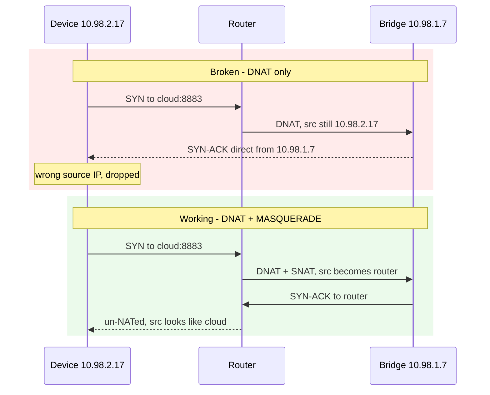

# Device Notes: GIEX Water Timer (GX-03WF)

Field findings from a live investigation on 2026-08-22 and 2026-08-24. This device is
the motivating case for extending the bridge to **port 8883**.

## Summary

| Property | Value |
|---|---|
| Model | `GX-03WF` |
| Tuya product id | `l5kmxcrf0ivlcxnt` |
| Category | `ggq` (irrigation) |
| Transport | Wi-Fi, always connected |
| Cloud endpoint | Tuya EU, TCP **8883** |
| Local LAN protocol | **absent** — see below |
| Handshake | **TLS-PSK** — bridgeable |
| Data points | `switch_1`, `switch_2`, `countdown_1`, `countdown_2`, `use_time_1`, `use_time_2`, `battery_percentage` |

## Why `tuya_local` cannot work

The device exposes **no local listener**. Repeated probes from the router, on the same
L2 segment, found ports 6668, 6667, 6669, 80 and 443 all closed, and it never emits the
Tuya UDP 6667 discovery broadcast that mains-powered Tuya Wi-Fi devices do.

Its `local_key` is obtainable from the Tuya IoT Platform API and is **not** the blocker —
there is simply nothing listening to connect to. Newer battery-device firmware ships the
Tuya LAN protocol disabled.

It is also not a sleeper: it holds a permanent TLS session with steady keepalives and
round-trips cloud commands in 1-2 seconds.

## The handshake is TLS-PSK

Captured by DNATing the device to a ClientHello probe. It offers **four** cipher suites
and **every one is PSK**. No certificate suites, no SNI:

| Code | Suite |
|---|---|
| `0x00a8` | `TLS_PSK_WITH_AES_128_GCM_SHA256` |
| `0x00ae` | `TLS_PSK_WITH_AES_128_CBC_SHA256` |
| `0xc037` | `TLS_ECDHE_PSK_WITH_AES_256_CBC_SHA384` |
| `0x00ff` | `TLS_EMPTY_RENEGOTIATION_INFO_SCSV` |

Raw record prefix:

```
1603030094010000900303 ... 000800a800aec03700ff0100003f
```

**`0x00ae` is the suite this bridge already implements.** No new crypto is required —
only a frontend bound to 8883.

## Gotcha: hairpin NAT

The bridge host and the device were both `/16` on the same `br-lan` segment
(`10.98.1.7` and `10.98.2.17`). A bare DNAT **silently fails**: the bridge answers the
device directly from its own address, the device sees a SYN-ACK from an unexpected IP and
drops it. Conntrack shows the flow stuck in `SYN_SENT [UNREPLIED]`.

A `POSTROUTING ... -j MASQUERADE` on the router is required so replies return via the
router and are un-NATed on the way back.



Required rules, scoped to the single host:

```sh
iptables -t nat -I PREROUTING  1 -s <device> -p tcp --dport 8883 -j DNAT --to-destination <bridge>:8883
iptables -t nat -I POSTROUTING 1 -s <device> -d <bridge> -p tcp --dport 8883 -j MASQUERADE
iptables -I FORWARD 1 -s <device> -d <bridge> -p tcp --dport 8883 -j ACCEPT
```

## Forcing a fresh handshake

The device is stubborn about re-handshaking. None of these worked:

- flushing its conntrack entry
- `DROP`ing its 8883 egress for 75s
- a 30s network block at the router

In every case it resumed the **same** TCP session, same source port, sequence continuing.
Only two things force a cold ClientHello:

1. a physical power cycle (battery pull), or
2. redirecting it to a host that accepts the TCP connection and then closes, which makes
   it tear down and reconnect.

Passive `tcpdump` on the router proved unreliable for this — captures consistently
reported ~200 "packets dropped by interface" and missed the handshake even when one
occurred. Terminating the connection is the reliable method.

## Open question

Whether the device accepts **commands** inbound over this channel or only reports state.
State reporting is certain; control is unverified. If it proves read-only, the bridge
still delivers independent verification that a watering run actually happened, which was
the original problem.
