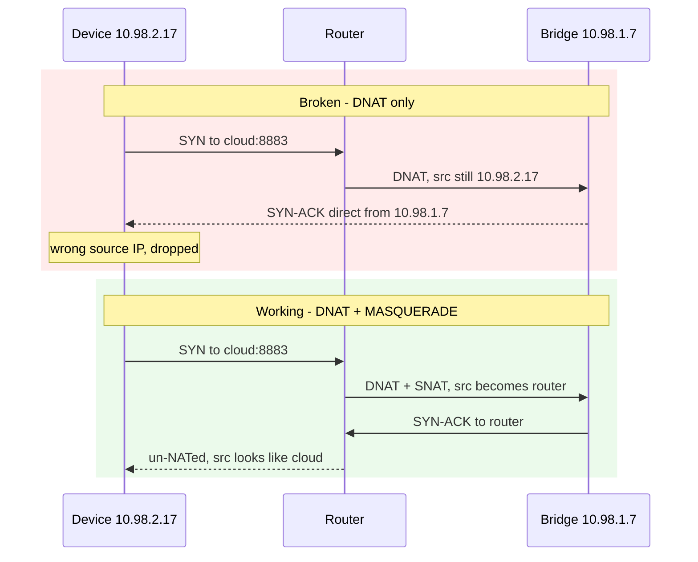
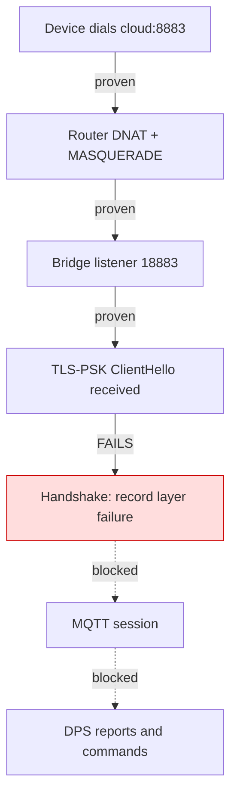

# Device Notes: GIEX Water Timer (GX-03WF)

Field findings from a live investigation on 2026-08-22 and 2026-08-24. This device is
the motivating case for extending the bridge to **port 8883**.

## Summary

| Property | Value |
|---|---|
| Model | `GX-03WF` |
| Tuya product id | `l5kmxcrf0ivlcxnt` |
| Category | `ggq` (irrigation) |
| Transport | Wi-Fi, always connected |
| Cloud endpoint | Tuya EU, TCP **8883** |
| Local LAN protocol | **absent** — see below |
| Handshake | **TLS-PSK** — bridgeable |
| Data points | See the DPS table below |

## Data points

Read from the Tuya IoT Platform thing model on 2026-08-24
(`GET /v2.0/cloud/thing/<device_id>/model`), which is authoritative for this product.
DPS numbering is **per-product** — a sibling dual timer in `tuya-local`
(`hct626_dual_watertimer.yaml`) puts battery on 47, and copying that would have been
wrong here.

| DPS | Code | Type | Access |
|---|---|---|---|
| 1 | `switch_1` | bool | rw |
| 2 | `switch_2` | bool | rw |
| 13 | `countdown_1` | integer, seconds | rw |
| 14 | `countdown_2` | integer, seconds | rw |
| 25 | `use_time_1` | integer, seconds | ro |
| 26 | `use_time_2` | integer, seconds | ro |
| 37 | `weather_delay` | enum | rw |
| 59 | `battery_percentage` | integer, % | rw |
| 103 | `fault` | enum | ro |
| 104 | `status_1` | enum `manual`/`auto`/`idle` | ro |
| 105 | `status_2` | enum `manual`/`auto`/`idle` | ro |

`status_1` and `status_2` appear in the thing model but are **not** returned by
`GET /v1.0/devices/<id>/status`, so they are not available through the cloud today.

`tuya-local` has no configuration for this device — a search of all 1,718 device configs
in that repository returned no match for GIEX or GX-03.

## Why `tuya_local` cannot work

The device exposes **no local listener**. Repeated probes from the router, on the same
L2 segment, found ports 6668, 6667, 6669, 80 and 443 all closed, and it never emits the
Tuya UDP 6667 discovery broadcast that mains-powered Tuya Wi-Fi devices do.

Its `local_key` is obtainable from the Tuya IoT Platform API and is **not** the blocker —
there is simply nothing listening to connect to. Newer battery-device firmware ships the
Tuya LAN protocol disabled.

It is also not a sleeper: it holds a permanent TLS session with steady keepalives and
round-trips cloud commands in 1-2 seconds.

## The handshake is TLS-PSK

Captured by DNATing the device to a ClientHello probe. It offers **four** cipher suites
and **every one is PSK**. No certificate suites, no SNI:

| Code | Suite |
|---|---|
| `0x00a8` | `TLS_PSK_WITH_AES_128_GCM_SHA256` |
| `0x00ae` | `TLS_PSK_WITH_AES_128_CBC_SHA256` |
| `0xc037` | `TLS_ECDHE_PSK_WITH_AES_256_CBC_SHA384` |
| `0x00ff` | `TLS_EMPTY_RENEGOTIATION_INFO_SCSV` |

Raw record prefix:

```
1603030094010000900303 ... 000800a800aec03700ff0100003f
```

**`0x00ae` is the suite this bridge already implements.**

That is where the good news stops. On 2026-08-24 the device was redirected to a live
bridge listener and **every handshake failed** — 17 attempts, 0 successes:

```
TLS-PSK handshake failed from 10.98.1.1:58082: [SSL] record layer failure
```

The cipher suite matches; the **pre-shared key does not**. So the earlier conclusion that
"no new crypto is required" was wrong: a frontend bound to the port is necessary but not
sufficient. `derive_psk` — proven against the door sensors — produces a key this device
rejects.

### What the identity looks like

The device presents a 49-byte PSK identity. Captured across two boots:

```
03 e4c4ea337a7e649b5f68076001f99c2c 7bc350dd6af304...6576be5ea
03 514d18c063bd8a22e8fde0faede3209c 7bc350dd6af304...6576be5ea
   ^^^^^^^^^^ 16 bytes, differ per boot  ^^^^^^^^^^ 32 bytes, identical
```

So the identity is a one-byte prefix, 16 per-boot bytes, and a 32-byte constant.
`derive_psk` encrypts `stripped[:32]`, which straddles the boundary — it mixes half the
per-boot nonce with half the constant. That is the most likely reason the derived key is
wrong, though it is not yet proven.

Derivation candidates can be tried in isolation with the `psk_variant` option, which the
runtime applies **only to non-primary ports**. The door sensors on `mqtt_psk_port` always
use `derive_psk`, so a failed experiment cannot reach a device that already works.

## Gotcha: hairpin NAT

The bridge host and the device were both `/16` on the same `br-lan` segment
(`10.98.1.7` and `10.98.2.17`). A bare DNAT **silently fails**: the bridge answers the
device directly from its own address, the device sees a SYN-ACK from an unexpected IP and
drops it. Conntrack shows the flow stuck in `SYN_SENT [UNREPLIED]`.

A `POSTROUTING ... -j MASQUERADE` on the router is required so replies return via the
router and are un-NATed on the way back.



Required rules, scoped to the single host. On the GL.iNet router the door sensors
already use the `prerouting_lan_rule` / `postrouting_lan_rule` chains, and no explicit
`FORWARD` accept is needed there:

```sh
iptables -t nat -A prerouting_lan_rule -s 10.98.2.17 -p tcp --dport 8883 \
  -j DNAT --to-destination 10.98.1.166:18883 \
  -m comment --comment tuya-psk-bridge-giex-dnat
iptables -t nat -A postrouting_lan_rule -s 10.98.2.17 -d 10.98.1.166 -p tcp --dport 18883 \
  -j MASQUERADE \
  -m comment --comment tuya-psk-bridge-giex-snat
```

Note the **destination port is 18883, not 8883**. `core-mosquitto` already binds 8883 on
the Home Assistant host for MQTTS, so the add-on cannot take it — the supervisor refuses
to start with `app_port_conflict`. DNAT rewrites the destination port anyway and the
device never checks it, so the bridge listens on 18883 and the rule redirects there.
The MASQUERADE rule must match the **post-DNAT** port.

## Forcing a fresh handshake

The device is stubborn about re-handshaking. None of these worked:

- flushing its conntrack entry
- `DROP`ing its 8883 egress for 75s
- a 30s network block at the router

In every case it resumed the **same** TCP session, same source port, sequence continuing.
Only two things force a cold ClientHello:

1. a physical power cycle (battery pull), or
2. redirecting it to a host that accepts the TCP connection and then closes, which makes
   it tear down and reconnect.

Passive `tcpdump` on the router proved unreliable for this — captures consistently
reported ~200 "packets dropped by interface" and missed the handshake even when one
occurred. Terminating the connection is the reliable method.

## Status as of 2026-08-24

| Layer | State |
|---|---|
| Router hairpin NAT | **Working** — both rule counters increment |
| TCP to the bridge on 18883 | **Working** — fresh connections, two-way traffic |
| Device sends ClientHello | **Working** |
| TLS-PSK handshake | **Fails** — wrong derived key |
| Everything above | Blocked on the handshake |



### What was ruled out

- **Wrong PSK hint.** Querying the real endpoint with
  `openssl s_client -connect 18.153.246.219:8883 -psk_identity x -psk 00 -cipher PSK-AES128-CBC-SHA256`
  returns `1dHRsc2NjbHltbGx3eWh50000000000000000`, identical to `DEFAULT_HINT`.
- **Wrong cipher suite.** The bridge offers `0x00ae`, which the device offers.
- **Transport.** Proven end to end.

Also ruled out, on 2026-08-24: the constant 32-byte tail of the PSK identity is **not** a
naive hash of anything the Tuya IoT Platform exposes. MD5, SHA-256 and raw forms of
`local_key`, `uuid` (`86087445e6b86d13`), serial, device id and MAC were compared, along
with pairwise concatenations. No match. So whatever feeds scheme `0x03`, it is not simply
a cloud-visible identifier hashed once.

### Not yet established

Five slicing variants of the existing derivation were attempted against the live device
and **none produced a result worth recording** — after roughly twenty failed handshakes
the device lengthened its retry backoff until test windows contained zero attempts. Those
runs are void, not negative.

The identity formats differ in a way that makes a shared derivation unlikely, so
guess-and-check on the slicing is probably the wrong search entirely.

### Identified: this is a different PSK scheme, and the byte says so

Byte 0 of the identity is a **scheme version**. `derive_psk` in this repo is, line for
line, the derivation from
[tuya-convert's `psk-frontend.py`](https://raw.githubusercontent.com/ct-Open-Source/tuya-convert/master/scripts/psk-frontend.py):
same hint, same `MD5`/`AES-128-CBC`, same 32-byte slice. That was verified directly
against upstream, not inferred.

Upstream does one thing this repo had dropped — it validates a fixed prefix before
deriving anything:

```python
IDENTITY_PREFIX = b"BAohbmd6aG91IFR1"
if identity[:16] != IDENTITY_PREFIX:  # after stripping the version byte
    reject
```

The door sensors carry that prefix exactly. **The GIEX does not.** Upstream would refuse
this identity as an unsupported scheme; our copy silently derived a wrong key instead,
which is why the only symptom was an opaque OpenSSL `record layer failure`. That guard is
now restored as a loud, named error — see `_SCHEME_1_PREFIX` in `psk_frontend.py`.

Version `0x03` corresponds to Tuya **PSK 3.0**. TuyaOS logs on that path report
`use mf psk key` — a *manufacturing* key written during production, distinct from
`local_key`. `local_key` is the **MQTT payload** key, not the TLS secret; the bridge uses
it correctly for AES payload decryption and it was never going to serve as the PSK.

### Consequence

If PSK 3.0 uses a random per-device factory key, this is not merely hard — it is
**cryptographically closed from outside**. No number of identity captures, product
metadata, or Tuya IoT Platform fields can recover a random secret. The remaining routes
all involve extracting it from the device:

1. Identify the Wi-Fi module/SoC by opening the unit and photographing the board.
2. Capture UART boot output, then dump SPI flash; preserve the original image and never
   write until it is verified.
3. Search the dump and any protected-storage export for `pskKey`, `psk30`, `mf`,
   `auth_key`, `uuid`, and certificate-manager material.
4. If flash is protected, instrument the running firmware at the PSK callback over
   UART/JTAG.

Further cold boots are **not** informative on their own — more samples of a random key's
public identity add nothing. Spend them only to capture a candidate source event.

### Acceptance criteria, if this is ever revisited

A successful handshake is necessary but **not** sufficient. Do not claim the device is
bridged until a **decoded DPS report** arrives, and do not claim control until a command
round-trip has been verified with a bounded, short valve actuation.

## Open question

Whether the device accepts **commands** inbound over this channel or only reports state
remains unanswered, and is now downstream of the handshake. Note the bridge itself gained
a command path on 2026-08-24 (see [protocol notes](./protocol-notes.md)), so the question
is purely about the device's behaviour, not the bridge's capability.

## Rollback record

The router rules were removed and verified gone on 2026-08-24 at 12:47 Sydney; the four
door-sensor rules were confirmed still present. The add-on was returned to its
door-sensor-only configuration, and the retained MQTT topics were compared against a
capture taken before the work: 12 topics, no additions, no changes. The timer reconnected
to Tuya cloud and reported within two minutes, both valves `off`.
