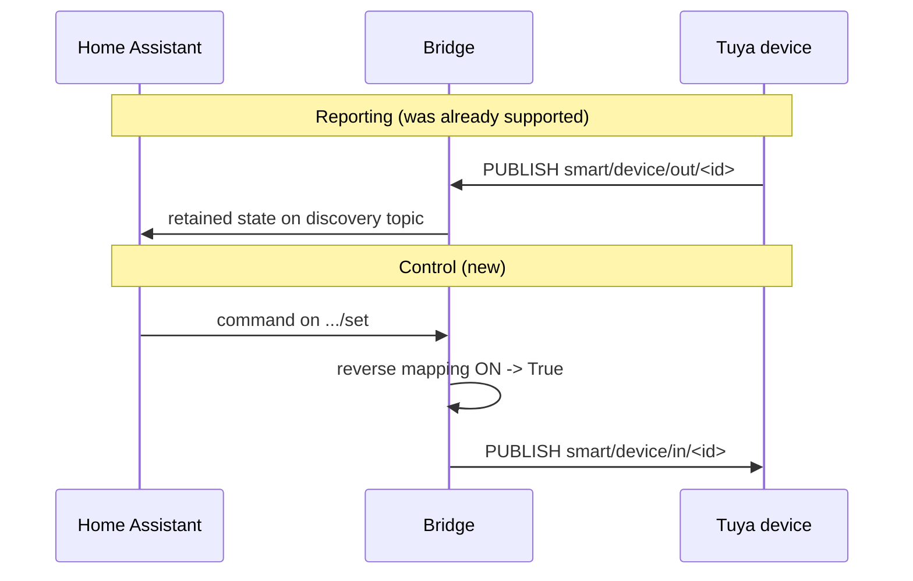
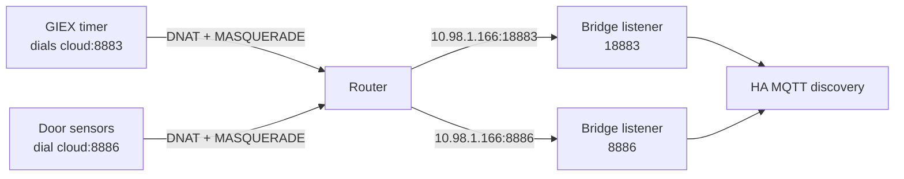

# Tuya Local Cloud Protocol Notes

Notes from lab analysis of Tuya Wi-Fi devices communicating with the
local cloud endpoint. These are reverse-engineered observations, not
official protocol documentation.

## TLS-PSK Handshake

Tuya Wi-Fi devices use **TLS-PSK** to connect to the local cloud endpoint.

- **Cipher suite**: `TLS_PSK_WITH_AES_128_CBC_SHA256`
- **PSK identity**: The device's `device_id` (16 hex characters).
- **PSK hint**: A server-side identifier used during negotiation.
- **Key material**: Derived from the device's `local_key` via an MD5-based
  derivation (see [PSK Derivation](#psk-derivation) below).

The bridge acts as a TLS-PSK server, accepting connections from devices
that have been redirected by router DNAT rules to the bridge's listening
port.

## PSK Derivation

The pre-shared key used in the TLS handshake is not the raw `local_key`
string. It is derived as follows:

1. Take the `local_key` string (a per-device secret, typically 16 characters).
2. The TLS-PSK identity and this key material are combined through an MD5-based
   AES-CBC construction to produce a 16-byte PSK.

This matches the observed behavior of the official Tuya cloud endpoint.
See `tuya_psk_bridge/psk_frontend.py` for the implementation.

## MQTT Payload Format (Tuya 2.2)

Inside the TLS session, devices communicate over MQTT. The payload follows
the Tuya 2.2 protocol format:

### Envelope

The first **15 bytes** of each MQTT payload are a protocol header that
must be stripped before decryption:

```
Bytes 0-2:  Protocol version marker (ASCII "2.2")
Bytes 3-14: Envelope metadata (sequence number, timestamp, flags, reserved)
```

The metadata bytes are protocol-internal and vary between messages; they
should be treated as opaque. The bridge simply strips the first 15 bytes.

After stripping the 15-byte envelope, the remaining bytes are the
AES-128-ECB encrypted application data.

### Decryption

- **Algorithm**: AES-128-ECB with PKCS#7 padding.
- **Key**: The device's `local_key` string encoded as UTF-8 (first 16 bytes used as the AES key).
- **Output**: UTF-8 JSON string.

### Decrypted JSON Structure

```json
{
  "protocol": 4,
  "t": 2,
  "data": {
    "devId": "<device_id>",
    "dps": {
      "1": "open"
    }
  }
}
```

Each key in the `dps` object is a data point ID (string). The value is
a string representation of the data point's current state.

## MQTT Topics

### Device Reporting Topic

Devices publish their state to:

```
smart/device/out/<device_id>
```

The bridge subscribes to this topic pattern to intercept device reports.

### Device Command Topic

Devices listen for commands on the mirror of their reporting topic:

```
smart/device/in/<device_id>
```

The bridge publishes here (QoS 0, no packet identifier) over the same TLS-PSK
session the device opened — a device only accepts commands on the connection it
established, so the bridge can only control a device that is currently connected.

The payload is built the same way a report is read, in reverse: JSON, AES-128-ECB
encrypted with the `local_key`, wrapped in the 15-byte `2.2` envelope. Control
messages carry `"protocol": 5`.



### Home Assistant MQTT Discovery

The bridge publishes HA discovery messages to:

```
homeassistant/<platform>/tuya_psk_<device_id>_<dps_id>/config
```

State messages are published to:

```
homeassistant/<platform>/tuya_psk_<device_id>_<dps_id>/state
```

## Known DPS Mappings

### Door/Window Sensor (Profile: `door_sensor`)

| DPS | Type | Values | HA Entity |
|---|---|---|---|
| `1` | Door state | `open`/`closed` | `binary_sensor` (device_class: `door`) |
| `101` | Unknown | `0x00` (constant) | Not mapped |

Typical mapping in bridge config:

```yaml
mappings:
  - dps: "1"
    platform: binary_sensor
    device_class: door
    values:
      open: "ON"
      closed: "OFF"
```

## Endpoint Ports

Not every Tuya device uses the same cloud port, and the port implies nothing about the
handshake — both observed ports negotiate TLS-PSK.

| Port | Seen on | Notes |
|---|---|---|
| 8886 | Wi-Fi door sensors | The originally supported endpoint. |
| 8883 | GIEX GX-03WF water timer | Same PSK crypto; offers `0x00ae`, which this bridge already implements. See [GIEX device notes](./device-giex-water-timer.md). |

Devices do **not** fall back between ports. Blocking one endpoint makes the device go
silent rather than try another, so a device can only be captured on the port it already
uses. The bridge therefore binds every port in `mqtt_psk_ports` at once, one listener
each, all sharing the same device configuration.

### Listener port vs device port

The port the bridge *binds* need not be the port the device *dials* — DNAT rewrites the
destination port, and Tuya devices do not check it. This matters on a Home Assistant
host, where `core-mosquitto` already owns 8883 for MQTTS. The deployed add-on listens on
**18883** and the router redirects the device's 8883 traffic there.



## References

- [Architecture overview](./architecture.md) - Component diagram and data flow.
- [GIEX water timer notes](./device-giex-water-timer.md) - Port 8883 findings and the hairpin-NAT requirement.
- [Security model](./security.md) - Threat model and secret handling.
- [OpenWrt redirect guide](./router-openwrt-glinet.md) - Router configuration for traffic redirection.
- Lab findings are recorded in `docs/security.md` under the PSK analysis section.
